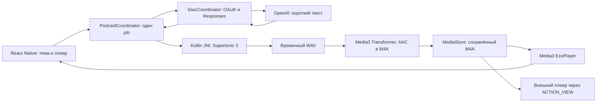

# Следующий прототип: тема → текст → локальная речь → прослушивание

Дата: 25 октября 2026 года. Статус: **реализован полный сценарий — тема → завершённый русский текст через SIWC → локальная озвучка → сохранённый M4A**. Инструкция: [LOCAL_TTS_TESTING.md](LOCAL_TTS_TESTING.md). Результаты проверки полного сценария: [DEVICE_PODCAST_TEST_2026-10-25.md](DEVICE_PODCAST_TEST_2026-10-25.md).
База: React Native Android-приложение `mobile/`, проверенный SIWC-код `2168399`; результаты предыдущего этапа — в [отчёте Pixel](DEVICE_TEST_2026-10-25.md).

## 1. Решение и границы

Развиваем установленное приложение. Пользователь задаёт тему или вопрос, нажимает «Создать», получает короткий законченный рассказ, затем его локальную озвучку и кнопку прослушивания. Это один диктор и один небольшой выпуск. Отдельный план, редактор сценария и многошаговый диалог пока не нужны.

Предлагаемая конфигурация: **SIWC / Responses → Supertonic 3 INT8 через sherpa-onnx → временный WAV → AAC в M4A → сохранение в MediaStore → свой или внешний плеер**. Текст создаётся через интернет за счёт уже проверенного OAuth-доступа. Озвучка и кодирование выполняются на Pixel; готовая запись проигрывается без сети. Mac нужен для сборки и установки.

| Параметр | Решение для этого прототипа |
| --- | --- |
| Устройство | Pixel 10 Pro, Android 17, arm64-v8a |
| Язык | Только русский, без переключателя языка |
| Ввод | Одна тема/вопрос, от 1 до 500 Unicode code points после trim |
| Текст | Ориентир 120–180 слов; приблизительно одна минута речи, без гарантии точного хронометража |
| Лимит текста для TTS | Непустой завершённый ответ, не более 3000 Unicode code points |
| Голос | Один фиксированный preset, первоначально `sid=0`; выбор на этапе прослушивания тестовых образцов |
| Записи | Один последний готовый файл и один незавершённый черновик; автоматическая очистка без отдельного UI |
| Конечный формат | `.m4a`: AAC-LC, mono, целевой битрейт 96 kbit/s; WAV — только промежуточный файл |
| Сохранение | Автоматически в `Podcasts/PodcastGenerator/`; предыдущий файл удаляется только после успешного сохранения нового |
| Внешний плеер | Кнопка «Открыть в другом приложении» для сохранённого файла |
| Проигрывание | Старт / пауза / сначала, позиция и длительность; без автозапуска |
| Фон | Создание выпуска и наш плеер работают при открытом приложении; внешний плеер управляет своим фоном самостоятельно |
| Поставка | Тестовый APK со встроенным JS и весами, без обязательного Metro |

25 октября пользователь подтвердил: в этом прототипе достаточно прослушивания при открытом приложении. Для нашего плеера фон и заблокированный экран перенесены в следующий этап; MediaSessionService и уведомление управления воспроизведением в текущую итерацию не входят. Внешний плеер может работать в фоне по своим правилам. Последующее уточнение пользователя: достаточно русского языка, обязательны сохранение файлов и открытие другим приложением, желателен MP3 или похожий конечный формат. Для этого выбран M4A/AAC.

Не входят: генерация и озвучка на английском, несколько ведущих, музыка, клонирование голоса, запись с микрофона, экран истории выпусков, отдельный MP3-кодировщик, выбор формата/папки в UI, загрузчик/каталог моделей, настройки качества, облачная озвучка, сервер на Mac, публикация в Play. Существующие вход, refresh, выход и безопасная диагностика сохраняются. Последний готовый файл доступен через файловый менеджер и внешний плеер. По уточнению пользователя храним только последний выпуск: отдельный экран или кнопка очистки для этого прототипа не нужны.

## 2. Выбор локальной озвучки

### Основной вариант: Supertonic 3 INT8 / sherpa-onnx

У модели есть русский и английский, фиксированные голоса и локальное исполнение. У sherpa-onnx опубликованы Android APK и Kotlin-пример для неё. Это подтверждает наличие пути интеграции, но **не подтверждает скорость и качество на нашем Pixel**. [Модель и Android-пример](https://k2-fsa.github.io/sherpa/onnx/tts/all/Russian/supertonic-3-ru.html), [поддержка Supertonic в sherpa-onnx](https://k2-fsa.github.io/sherpa/onnx/tts/supertonic.html).

Важная особенность выбора: исходный проект Supertonic архивирован авторами 9 сентября 2026 года; их README сообщает об окончании разработки и поддержки. Веса остаются доступны. Для прототипа фиксируем существующий пакет и используем отдельный runtime sherpa-onnx, у которого есть релиз `v2.0.0` от 23 октября. Не строим интеграцию на размещённых демо или Voice Builder. [Архив исходного проекта](https://github.com/supertone-oss-archive/supertonic), [релиз sherpa-onnx](https://github.com/k2-fsa/sherpa-onnx/releases/tag/v2.0.0).

Начальные параметры для замера: CPU, `numThreads=2`, `numSteps=8`, `speed=1.0`, фиксированный `lang=ru`, `sid=0`, debug-вывод runtime выключен. Python не включается в Android-приложение; используем Kotlin/JNI. Полную генеративную цепочку из четырёх ONNX-моделей вручную не переносим. Многоязычный пакет модели остаётся тем же: отключение английского в UI не уменьшает автоматически размер весов.

### Почему остальные варианты не выбираем первыми

| Вариант | Оценка для этого этапа |
| --- | --- |
| Supertonic 3 / sherpa-onnx | Основной кандидат: есть готовый Kotlin/Android-путь и один пакет для RU/EN. Архивирование исходного проекта учитываем как ограничение сопровождения |
| Системный Android TextToSpeech | Самый простой запасной вариант для проверки интерфейса, но конкретный голос зависит от установленного движка. Офлайн-режим нужно проверять через свойства голоса и авиарежим. Не является проверкой выбранной встроенной модели |
| Piper | Есть русские модели и Android-примеры. Отдельные голоса для языков; нужно выбрать голос, проверить его лицензию и фонемизатор. В sherpa-onnx 2.0 встроенный espeak/piper-phonemize вынесен из ядра, поэтому это не обещанный переключатель конфигурации без дополнительной работы |
| Qwen3-TTS | Есть RU/EN и варианты 0.6B/1.7B. Официальный quickstart ориентирован на Python; Android-runtime, память и конвертацию потребуется исследовать отдельно. Для первого сквозного теста это дополнительный объём |
| Chatterbox Multilingual | Есть RU/EN; текущая мультиязычная модель 0.5B. Официальный путь также требует отдельной Android-интеграции и измерений. Оставляем для сравнения качества после рабочего сквозного сценария |

Основания сравнения: [Android Voice](https://developer.android.com/reference/android/speech/tts/Voice), [Piper Irina в sherpa-onnx](https://k2-fsa.github.io/sherpa/onnx/tts/all/Russian/vits-piper-ru_RU-irina-medium.html), [изменения sherpa-onnx 2.0](https://github.com/k2-fsa/sherpa-onnx/releases/tag/v2.0.0), [Qwen3-TTS](https://github.com/QwenLM/Qwen3-TTS), [Chatterbox](https://github.com/resemble-ai/chatterbox). Вывод о сложности интеграции — инженерная оценка для нашего приложения, не результат сравнительного бенчмарка.

В приложении реализуем один TTS engine. Если контрольный запуск Supertonic на Pixel не проходит, сначала фиксируем причину и меняем решение в этой спецификации; скрытого переключения на облако или системный голос не будет.

## 3. Зависимости и доставка весов

Сохраняем React Native 0.86.3, текущие JDK/Gradle/NDK, minSdk 31 и compile/target SDK 36. Сохраняем application ID `dev.podcast.siwcspike` и ключ подписи для установки поверх существующей версии. Для полного сценария versionCode увеличен до 3, versionName до 1.2 (первый тест озвучки был 2 / 1.1).

Добавления при реализации:

- Kotlin API и Android JNI-библиотеки **одного релиза sherpa-onnx v2.0.0**. Брать обычный Android-архив, не Termux/RKNN/WASM; включить только arm64-v8a. Kotlin binding из того же тега: [Tts.kt](https://github.com/k2-fsa/sherpa-onnx/blob/v2.0.0/sherpa-onnx/kotlin-api/Tts.kt). Не придумывать Maven-координаты и не брать binding из master к старой `.so`.
- `androidx.media3:media3-exoplayer:1.11.1`; RN рисует собственные кнопки, `media3-ui`/DASH не нужны. В source catalog этого релиза compileSdk 36, minSdk 23; совместимость полного dependency graph дополнительно проверить сборкой. [Документация Media3](https://developer.android.com/media/media3/exoplayer/hello-world), [версии исходного релиза](https://github.com/androidx/media/blob/1.11.1/gradle/libs.versions.toml).
- `androidx.media3:media3-transformer:1.11.1` для преобразования WAV в AAC/M4A. Все модули Media3 одной версии. Transformer использует MediaCodec для кодирования и поддерживает MP4-контейнер; отдельный FFmpeg или MP3 encoder не нужен. [Форматы Transformer](https://developer.android.com/media/media3/transformer/supported-formats), [подключение и завершение/отмена экспорта](https://developer.android.com/media/media3/transformer/getting-started).
- Готовый пакет весов, конфигурации и голосов, указанный ниже. Не добавлять вторую отдельную сборку ONNX Runtime поверх runtime из поставки sherpa без необходимости.

Публичные метаданные GitHub Releases проверены 25 октября. При реализации первого TTS-теста архивы скачаны; их фактические SHA-256 совпали со значениями ниже из release metadata. Скрипт подготовки повторно проверяет hashes и при использовании локального кэша.

| Артефакт | Размер архива | SHA-256 |
| --- | --- | --- |
| `sherpa-onnx-v2.0.0-android.tar.bz2` | 45 166 118 байт, все предоставленные ABI | `578650d0221255566bd7c88bd3a0deeb974b8562a332a6a875b35bd00b7e0f5d` |
| `sherpa-onnx-supertonic-3-tts-int8-2026-05-11.tar.bz2` | 128 774 318 байт, около 122.8 MiB | `82fa96f91c4ef8abaae3a14a3f4153facf88bed821d1f7331cec2700f432c427` |

Источники: [метаданные runtime](https://api.github.com/repos/k2-fsa/sherpa-onnx/releases/tags/v2.0.0), [метаданные моделей](https://api.github.com/repos/k2-fsa/sherpa-onnx/releases/tags/tts-models). Скачать при реализации из release assets по этим именам. Размер архива не равен размеру APK, распакованных файлов или потреблению RAM.

Нужные файлы модели: `duration_predictor.int8.onnx`, `text_encoder.int8.onnx`, `vector_estimator.int8.onnx`, `vocoder.int8.onnx`, `tts.json`, `unicode_indexer.bin`, `voice.bin`. Использовать весь согласованный пакет; файлы исходной FP32-модели с JSON voice styles не подмешивать в него.

Для минимальности веса включаем в `assets/tts/supertonic3/` тестового APK. JNI API принимает AssetManager; контрольный запуск должен проверить работу с assets именно этого пакета. Загрузки весов при первом запуске приложения нет. Если понадобится извлечение в приватный каталог, добавить его только после измерения/проверки native API, с проверкой manifest и атомарным завершением копирования.

Реализованный `tools/prepare-tts-assets.py` скачивает и проверяет закреплённые архивы на Mac, подготавливает игнорируемые Git assets/JNI. Скрипт использует стандартную библиотеку Python без дополнительных пакетов. В репозитории храним небольшой manifest с именами, версиями, URL, hashes и лицензиями, но не веса/APK. Model license — OpenRAIL-M; лицензии модели, sherpa-onnx и ONNX Runtime включены в assets. MIT-файл внутри архива модели относится к sample code и не заменяет отдельную лицензию весов. [Карточка модели](https://huggingface.co/Supertone/supertonic-3).

До интеграции проверить: ABI/JNI-символы, совместимость с Android 17 и 16 KiB pages, дубликаты `libc++_shared.so`/ORT в RN-сборке и AAR metadata Media3. Конфликт библиотек не скрывать произвольным `pickFirst`; выбрать совместимую поставку. Это проверки сборки будущего этапа, не результаты сегодняшней работы.

## 4. Пользовательский сценарий

Один основной экран:

1. Компактный статус ChatGPT и вход при необходимости. Технические кнопки модели/refresh/выхода/диагностики остаются в раскрываемом блоке.
2. Поле «О чём рассказать?». Рассказ всегда на русском; переключателя языка нет. Пример темы можно показать placeholder, не отправлять автоматически.
3. «Создать подкаст». Перед сетевым запросом проверяем ввод, модель речи, наличие AAC encoder, свободное место, сессию и текстовую модель. Модель TTS инициализируем до расходования запроса OpenAI.
4. Этапы «Подготавливаем голос» → «Создаём текст» → «Озвучиваем, фрагмент X из N» → «Сжимаем аудио» → «Сохраняем файл». Во время работы доступна отмена, повторный запуск заблокирован.
5. После `response.completed` можно показывать текст. Озвучка, кодирование и сохранение запускаются последовательно автоматически. «Готово» означает, что полный M4A уже сохранён в общей папке, а не только в cache приложения.
6. Карточка готового выпуска: тема, текст, имя файла и папка, «Слушать / Пауза», «Сначала», позиция и длительность, «Открыть в другом приложении». Прослушивание запускается только по действию пользователя.

При ошибке TTS сохраняем завершённый текст и показываем «Повторить озвучку»: повторный запрос к OpenAI не нужен. При ошибке кодирования сохраняем полный WAV для повтора сжатия, при ошибке записи в MediaStore — готовый приватный M4A для повтора сохранения. Если ошибка произошла до завершения текста, повторяется текстовая генерация по явному действию. Редактирование темы не меняет уже созданный выпуск; у результата есть собственные metadata и ID.

## 5. Получение текста через существующий SIWC

Переиспользуем текущие CredentialStore, RefreshFlow, discovery, каталог моделей и SSE parser. OAuth-токены остаются в Kotlin. Не делаем отдельную OAuth-сессию и не переносим запросы с bearer в JS.

После входа каталог можно загрузить автоматически. Выбор модели: ранее выбранный доступный slug, иначе первый видимый из каталога. Пользователь может поменять её в раскрываемом блоке. Не считать GPT-6.1-Sol неизменным ID для всех аккаунтов.

`POST /v1/responses`: `store:false`, `stream:true`, `input` — массив. Постоянные требования к рассказу передаём в `instructions`, тему — отдельным user input. Не добавляем `max_output_tokens`/`temperature`, потому что текущий SIWC route их не поддерживает. [Официальные ограничения SIWC](https://developers.openai.com/siwc/token-sharing-open-source/preview-limitations).

Смысл инструкции модели:

> Создай короткий самостоятельный рассказ на русском языке для одного диктора, независимо от языка темы. Ориентир — от ста двадцати до ста восьмидесяти слов, не более трёх тысяч символов. Дай понятное вступление, объяснение и короткое завершение. Верни только текст для произнесения, без заголовка, списков, Markdown, URL, ролей и режиссёрских пометок. По возможности пиши числа словами. Тема находится в пользовательском сообщении.

Это проект нашего prompt, не цитата документации. Поиска, инструментов и истории в запросе нет. Цель — проверка рассказа по теме; отдельная функция исследования источников сюда не входит.

Длина в prompt — пожелание модели. Клиент дополнительно ограничивает накапливаемый результат 3000 code points и проверяет завершение. При превышении лимита прекращает запрос и предлагает создать текст заново; не обрезает его молча посреди предложения. Пустой ответ, refusal без текста, `response.incomplete`, ошибка, отмена и EOF до completion не запускают TTS. Нормализация ограничена пробелами/переносами строк; управляющие TTS-теги и неоговорённая разметка не должны превращаться в команды синтеза.

Сетевые тайм-ауты текущего прототипа остаются: соединение 15 сек, чтение 60 сек, общий 120 сек. Не повторяем автоматически генерацию после частичного ответа. Если refresh требует нового входа, возвращаем пользователя к существующему SIWC-потоку, сохраняя введённую тему.

## 6. Состав кода и состояния

| Компонент | Минимальное изменение |
| --- | --- |
| `App.tsx` | Основной сценарий подкаста, отдельные состояния генерации и проигрывания; существующий SIWC-блок свернуть |
| `SiwcCoordinator` | Выделить существующий streaming-вызов в общий внутренний путь; добавить native метод получения завершённого script с progress/result/error callback |
| `PodcastCoordinator` | Process-owned singleton: один job, его ID/revision, последовательность text → TTS → encode → save, отмена и snapshot |
| `LocalTtsEngine` | Небольшой Kotlin adapter над одним OfflineTts: prepare, synthesize, release; без framework выбора движков |
| `AudioEncoder` | Небольшой adapter над Transformer: завершённый WAV → AAC/M4A, отмена и результат |
| `EpisodeStore` | Черновик и промежуточные файлы, публикация M4A через MediaStore, атомарный указатель на последний выпуск и удаление предыдущего после сохранения нового; открытие URI внешним приложением |
| `PodcastPlayer` | Один ExoPlayer и его lifecycle/audio focus; работа на main looper |
| `NativePodcast.ts` / Kotlin module | Узкий Codegen-контракт управления и безопасных snapshots |

Предлагаемые bridge-методы: `getSnapshot`, `create(topic, modelSlug)`, `cancel`, `retryFailedStage`, `play`, `pause`, `restartPlayback`, `openExternal`; событие `onSnapshot`. Native выбирает допустимую точку повтора по сохранённому артефакту: script → TTS, WAV → encode, M4A → save. Текст можно передавать в UI; PCM, токены и большие массивы через JS bridge не передавать. Плеер и external open работают с известным episode ID и его сохранённым URI, а не произвольным путём от JS. `language=ru` остаётся в metadata для будущих версий.

Генерация: `Idle → PreparingVoice → GeneratingText → Synthesizing → Encoding → Saving → Ready`, отдельно `Cancelling`, `Cancelled`, `Failed`. Плеер: `Stopped / Preparing / Playing / Paused / Ended / Failed`. Auth-state остаётся в SIWC. Загрузка моделей или refresh не должны менять признак готовности уже сохранённого аудио. Успех TTS или кодирования сам по себе ещё не означает Ready.

Native coordinator управляет переходами; UI не запускает TTS из React useEffect при каждом событии Completed. Поздние callbacks проверяются по job ID, snapshots — по revision. Один вызов OpenAI относится ровно к одной попытке; отменённый job не может записать результат поверх нового.

Сеть остаётся на существующем SIWC executor, TTS и файловый I/O работают на отдельном одном worker. Во время создания подкаста вход/выход/refresh и диагностический запрос сериализованы или возвращают `operation_busy`; проверка есть и в native коде. Playback-команды и управление Transformer выполняются на одном main looper; само кодирование асинхронное. Новые DI, Redux, Room и навигационный framework не требуются.

## 7. Синтез, конечный формат и сохранение файлов

### Синтез

После полного русского текста разбиваем его на фразы по предложениям, ориентировочно 200–400 символов, максимум 500 code points на фрагмент. Длинное предложение делим по границе слова; не разрезаем UTF-16 surrogate pair. Сохраняем пунктуацию. Правила разбиения покрыть тестами русских предложений, чисел, сокращений, иностранных имён и длинного слова.

Фрагменты обрабатываются последовательно одним голосом и языком. Используем `generateWithConfigAndCallback`; callback проверяет отмену и возвращает stop по контракту runtime. При отсутствии своевременных callbacks отмена может дождаться завершения текущего фрагмента. Не обещаем мгновенное прерывание JNI, не освобождаем модель одновременно с inference.

PCM остаётся в Kotlin/native. Записываем один mono PCM16 WAV во временный файл, добавляя samples по порядку, без накопления всего аудио в JS. Не склеиваем WAV-файлы вместе с их заголовками. Дополнительную паузу между фрагментами первоначально не добавляем: сначала проверить паузы самой модели.

Частоту берём из `GeneratedAudio.sampleRate` и проверяем её одинаковость для всех фрагментов. В разных upstream-описаниях встречаются 24 kHz и 44.1 kHz; жёстко зашивать число по README нельзя. Размер и WAV-заголовок завершаются по фактическим samples; примеры кода API подтверждают наличие sampleRate у результата. [Kotlin API](https://github.com/k2-fsa/sherpa-onnx/blob/v2.0.0/sherpa-onnx/kotlin-api/Tts.kt).

Для ориентира, 90 секунд mono PCM16 занимают около 4.3 MB при 24 kHz или 7.9 MB при 44.1 kHz. Это расчёт формата, не измерение результата модели. Проверяем свободное место до старта и ошибки записи в процессе.

### Конечный формат: M4A с AAC-LC

Android штатно поддерживает AAC-LC encoder и MPEG-4 audio (`.m4a`). Для MP3 гарантировано декодирование, но не наличие системного encoder. Поэтому для этого прототипа выбираем M4A: отдельная поставка MP3 encoder сейчас не требуется. MP3 остаётся возможным следующим форматом, если появится требование именно к этому расширению. [Поддерживаемые форматы Android](https://developer.android.com/media/platform/supported-formats).

Целевые настройки: AAC-LC, mono, 96 kbit/s. При таком битрейте минута занимает около 0.72 MB плюс небольшой overhead контейнера; фактический размер измеряем. Частоту по возможности сохраняем из WAV; поддерживаемую encoder конфигурацию проверяем на Pixel. Если требуется resampling, он должен быть явным, с записью фактической частоты в metadata. Не менять sample rate только в заголовке.

Transformer получает завершённый WAV, кодирует аудио в AAC (`MimeTypes.AUDIO_AAC`) и записывает MP4 audio-only с расширением `.m4a`. Кодируем весь выпуск один раз после сборки PCM: независимые AAC-фрагменты не склеиваем. Обрабатываем completion/error/cancel; частичный выход не принимаем за готовый. После completion проверяем наличие одной AAC-аудиодорожки, отсутствие видео, ненулевые duration/размер и открываемость файла. Конечный MIME — `audio/mp4`, а не MIME сырого AAC. Это реальное кодирование и упаковка, а не переименование WAV. [Входные и выходные форматы Transformer](https://developer.android.com/media/media3/transformer/supported-formats).

### Обязательное сохранение

Храним один последний готовый M4A в `Podcasts/PodcastGenerator/` общей памяти телефона. Новый выпуск получает уникальное имя `podcast-YYYYMMDD-HHmmss-<shortId>.m4a`, без темы. Сначала полностью сохраняем новый файл, затем удаляем предыдущий: не перезаписываем его содержимое во время генерации. При ошибке или отмене до сохранения нового выпуска прежний остаётся доступен. Выход из ChatGPT его не удаляет. UI показывает имя и папку последнего файла; экран библиотеки и кнопка очистки не нужны.

Ограничение «один файл» относится к готовым выпускам, которыми управляет приложение. Во время замены временно могут существовать старый и новый файлы; после успешной очистки остаётся новый. Пользовательские копии и посторонние файлы в папке не трогаем. Внешнему плееру передаётся текущий файл; после успешного создания следующего прежний URI больше не гарантированно доступен, завершения внешнего прослушивания приложение не отслеживает.

Используем `MediaStore.Audio` на `VOLUME_EXTERNAL_PRIMARY`, `RELATIVE_PATH=Podcasts/PodcastGenerator/`, `DISPLAY_NAME`, `MIME_TYPE=audio/mp4`. Для собственных записей на наших API 31+ разрешения на всё хранилище/чтение чужого аудио не нужны. Общие media-файлы сохраняются даже после удаления приложения; его приватные metadata — нет. [Общие media-файлы и разрешения](https://developer.android.com/training/data-storage/shared/media).

Порядок завершения:

1. В `noBackupFilesDir/podcast/<jobId>/` сохранить script, завершённый WAV и проверенный M4A. Промежуточные выходы имеют отдельные `.part` имена; состояние готовности и URI прежнего выпуска хранятся в атомарном job manifest до публикации нового.
2. Создать запись MediaStore с `IS_PENDING=1`, записать её URI в manifest и скопировать полный M4A через ContentResolver на worker. Закрыть поток, проверить успешность записи и размер.
3. Перед публикацией проверить отмену. Только завершённому файлу установить `IS_PENDING=0`, затем атомарно обновить `current.json`: новый URI и URI прежнего выпуска, ожидающего удаления. До этой точки сохранение не считается успешным. Успешно опубликованный файл при поздней отмене не удалять; согласовать состояние job с фактом публикации.
4. Освободить старый файл в нашем плеере и удалить через ContentResolver только прежний принадлежащий приложению URI из manifest. Отсутствие уже удалённого файла считается успешной очисткой. После удаления очистить отметку в `current.json`; новый файл доступен как Ready. Нельзя очищать всю папку по маске или удалять текущий URI.
5. Удалить промежуточные WAV/M4A после подтверждённого сохранения. Приватно оставить metadata последнего выпуска, отметку незавершённой очистки при необходимости и не более одного черновика для повтора. При явном запуске нового выпуска устаревший черновик и его временные файлы заменяются новым.

После process death сверяем manifest с состоянием записанного URI: завершённую публикацию восстанавливаем, незавершённую pending-запись удаляем, повтор сохранения создаёт новый pending-файл из полного приватного M4A. Manifest хранит также прежний URI, чтобы после сбоя между публикацией и обновлением current можно было закончить замену. Не публиковать обрезанный файл и не создавать дубликат уже опубликованного выпуска. Малое окно между insert и сохранением URI обрабатываем поиском собственного pending-файла по уникальному job ID в имени. Автоматически генерацию и кодирование не возобновляем.

Если удалить прежний файл не удалось, новый остаётся готовым и доступным для прослушивания. Сохраняем отметку очистки, показываем короткий статус и автоматически повторяем удаление при следующем запуске или перед новой генерацией. Пока очистка не завершилась, новый job не начинаем, чтобы файлы не накапливались. Ошибка очистки не должна удалять новый файл, откатывать current на старый или вызывать повтор OpenAI/TTS. Отдельной кнопки очистки не добавляем.

Metadata: schemaVersion, episode/job ID, тема, `language=ru`, текст, модель текста, TTS package hash/voice, дата, фактические codec/sample rate/duration/размер, display name и content URI. Текст и metadata остаются приватными, готовое аудио — в общей media-папке. OAuth-секретов в этих файлах нет. При нехватке места не удаляем последний готовый выпуск ради начала нового: сначала должно хватить места для безопасной замены. Если пользователь удалил/переместил файл извне, показываем «Файл недоступен» без сброса SIWC и скрытой повторной генерации.

### Открытие внешним плеером

Кнопка доступна только для сохранённого M4A. При нажатии ставим собственный плеер на паузу и запускаем системный выбор приложения: `ACTION_VIEW`, URI файла `content://`, MIME `audio/mp4`, `FLAG_GRANT_READ_URI_PERMISSION`; тот же URI добавляем в ClipData для передачи разрешения через chooser. Не передаём `file://` и приватный путь, не выдаём право записи. FileProvider для URI MediaStore не требуется.

Запускаем intent и обрабатываем `ActivityNotFoundException`/ошибку доступа. При отсутствии совместимого приложения файл всё равно сохранён; показываем имя/папку и сохраняем возможность прослушивания внутри приложения. Не делаем вывод об отсутствии плеера только из `resolveActivity()` без учёта package visibility. Сам запуск intent не доказывает, что внешний плеер воспроизвёл файл — это отдельная проверка на Pixel. [Открытие файлов и URI grants](https://developer.android.com/training/package-visibility/use-cases), [intent для аудио](https://developer.android.com/guide/components/intents-common#Music).

## 8. Прослушивание и жизненный цикл

Media3 получает content URI сохранённого M4A. Настраиваем audio attributes для речи/media, audio focus и паузу при отключении наушников. Все команды ExoPlayer выполняются на одном main looper. [Рекомендации Media3 по потокам](https://developer.android.com/media/media3/exoplayer/hello-world).

«Слушать» запускает/продолжает запись, «Пауза» сохраняет позицию, «Сначала» переводит на начало. По завершении доступно повторное прослушивание. Автоматического воспроизведения сразу после TTS нет. Position/duration обновляем в UI не чаще четырёх раз в секунду.

Режим этой версии — «только открытое приложение»: при уходе в фон или блокировке экрана наш плеер ставится на паузу, незавершённое создание выпуска получает отмену, включая Transformer и копирование до публикации. Пока идёт создание, можно держать экран включённым оконным флагом; снять его при завершении/ошибке/отмене. После возврата показываем сохранённый текст/выпуск и возможность повтора нужного этапа. Прослушивание продолжается с позиции паузы по нажатию пользователя; автоматически звук не запускается. Открытие готового файла внешним плеером не отменяет сохранение и не удаляет файл; дальнейший фон/блокировку обрабатывает внешний плеер.

Отмена JNI кооперативная: UI сразу показывает Cancelling, новый job запрещён до выхода worker из текущего вызова. При убийстве процесса готовый выпуск остаётся на диске, незавершённый не считается готовым. Длительность синтеза отслеживаем; если она превышает двухминутный контрольный предел, запрашиваем отмену, но не обещаем жёсткого убийства native операции ровно в этот момент.

В следующей версии с фоновым воспроизведением плеер потребуется перенести в MediaSessionService с mediaPlayback foreground service/notification; генерация текста и TTS при этом всё ещё требует отдельного решения. Сам сервис плеера не делает синтез устойчивым к убийству процесса. [Фоновое воспроизведение Android](https://developer.android.com/media/media3/session/background-playback).

## 9. Ошибки и диагностические артефакты

| Ошибка | Что сохраняем / что предлагает UI |
| --- | --- |
| SIWC / сеть / лимит / истёкшая сессия | Введённую тему; существующее объяснение, вход или ручной повтор |
| Пустой, слишком длинный или незавершённый текст | Без аудио; понятный статус и повтор генерации |
| Весов нет / hash не совпал / JNI не загрузился | Не обращаться к OpenAI; диагностический код, требуется исправленная сборка |
| Нет подходящего AAC encoder | Ошибка предварительной проверки; не расходовать запрос OpenAI, проверить конфигурацию на Pixel |
| Ошибка синтеза / нехватка памяти | Завершённый script; удалить partial audio, предложить повторить озвучку |
| Ошибка кодирования M4A | Полный WAV и script; удалить частичный M4A, предложить повторить сжатие без TTS/OpenAI |
| Нет места / ошибка записи WAV | Script и последний готовый выпуск; повтор после освобождения места |
| Ошибка публикации в MediaStore | Готовый приватный M4A; убрать неполную pending-запись, предложить повтор сохранения без TTS/OpenAI |
| Не удалось удалить предыдущий файл | Новый выпуск готов; отметка очистки, автоматический повтор до следующей генерации, без отдельной кнопки |
| Проигрывание не удалось | Сохранённый файл; отдельная ошибка playback без сброса SIWC |
| Нет внешнего плеера / intent отклонён | Файл и его имя/папку; объяснение и внутреннее прослушивание |
| Файл удалён или недоступен извне | Metadata; показать недоступность, не запускать генерацию автоматически |
| Отмена / background / process death | Последний готовый выпуск сохраняется; cleanup partial/pending, восстановление публикации и очистки прежнего URI, защита от поздних callbacks |

Безопасная диагностика: этап, job ID, версии приложения/runtime/пакета, язык, voice ID, длительности этапов, число символов/фрагментов, codec, длительность/размер аудио, статус сохранения/вызова external open, error code и имеющийся request ID. Имя/папка и URI нужны UI/native, но не автоматическому экспорту диагностики. Тема, script, PCM, email, OAuth URL и токены также не входят в логи. Для каждой реальной ошибки дополняем [журнал](SIWC_ERROR_LOG.md) симптомом, причиной, изменением и повторной проверкой.

## 10. Порядок реализации и проверки

**Шаг 1 — TTS отдельно от OpenAI.** Подготовить закреплённые зависимости и веса. На Pixel синтезировать фиксированные короткие русские тексты через native API, сохранить промежуточный WAV, проверить его прослушивание. Измерить cold init, время синтеза, sample rate, duration, peak PSS и размер APK. Шаг выполнен; фактические результаты описаны в DEVICE_TTS_TEST_2026-10-25.md.

**Шаг 2 — конечный файл и плееры.** Встроить Transformer и ExoPlayer. Преобразовать WAV в AAC/M4A, сохранить через MediaStore, открыть своим и установленным внешним плеером. Проверить реальную дорожку/контейнер, длительность и начало/конец речи, имя/папку, повторное открытие после перезапуска и через файловый менеджер, паузу/повтор/наушники/фон нашего плеера, работу без сети. Создать два выпуска последовательно: первый остаётся до завершения второго, после успешной замены в папке остаётся только второй файл приложения.

**Шаг 3 — текстовый контракт.** Минимально выделить существующий SSE-путь без изменения OAuth/refresh. Добавить prompt, лимиты, обязательный completion и новый экран темы.

**Шаг 4 — сквозной job.** Соединить шаги, добавить отмену, повтор только неудачного этапа, изоляцию по job ID, восстановление незавершённого сохранения/очистки и защиту последнего готового файла при сбое.

**Шаг 5 — приёмка на Pixel.** Release APK через USB, без Metro; собственный небольшой отчёт с commit/hash APK, конфигурацией голоса, замерами и результатами ниже. Проверка локальной озвучки уже начата; полный сценарий от темы пользователя проверяется после подключения текстового этапа.

Минимальные автоматические проверки: текстовые лимиты и разбиение русского текста; отсутствие TTS при interrupted/incomplete/failed; один синтез на Completed; отмена и поздний callback; повтор TTS без OpenAI, кодирования без TTS, сохранения без кодирования; корректный WAV, отсутствие Ready до публикации M4A, отмена/сбой pending-записи и восстановление уже опубликованного URI без дубликата; удаление прежнего URI только после сохранения нового, возобновление очистки после сбоя без удаления текущего/посторонних файлов, запрет накопления при ошибке очистки; исключение содержимого и токенов из диагностики. Сохраняем существующие 18 JVM-тестов refresh/протокола и JS-проверку диагностики. Для JNI, MediaCodec, MediaStore, внешних intents и качества звука нужны реальные device checks, одних mocks недостаточно.

Критерии приёмки:

1. Тема → законченный русский script → M4A с AAC-аудиодорожкой в `Podcasts/PodcastGenerator/` → воспроизведение до конца. Переключателя языка нет.
2. Различимая речь соответствует тексту; нет пропущенных/повторённых фрагментов, обрыва окончания и заметных щелчков на стыках.
3. После завершённого текста включить авиарежим и повторить озвучку; синтез, кодирование, сохранение и оба плеера работают без сети. После перезапуска готовый выпуск также доступен офлайн.
4. Отмена/сбой на этапах текста, TTS, Encoding и Saving не выдаёт partial audio за готовое и не портит последний готовый выпуск. После перезапуска нет видимых обрезанных файлов или дубликатов сохранения. UI не зависает при JNI.
5. Ошибка TTS допускает повтор без обращения к модели текста; ошибка кодирования/сохранения — повтор соответствующего этапа. После двух успешных генераций остаётся только второй M4A; если третий выпуск не удался, второй по-прежнему доступен. После сбоя во время удаления первого файла очистка завершается повторно, сохраняя второй; посторонние файлы не затронуты.
6. Установкой поверх текущей версии сохранён SIWC-вход; ответ, refresh, выход и повторный вход не регрессировали.
7. При сворачивании приложения или блокировке экрана звук нашего плеера ставится на паузу. После возврата не запускается автоматически; пользователь может продолжить с позиции паузы.
8. «Открыть в другом приложении» передаёт сохранённый файл установленному совместимому плееру; проверить звук и перемотку до конца. Отсутствие обработчика/отмена chooser не удаляет файл и не ломает внутренний плеер.
9. Через файловый менеджер виден последний M4A; он повторно открывается после остановки нашего приложения и выхода из ChatGPT. Внешнее удаление файла даёт понятный статус без нового AI-запроса. Отдельного механизма ручной очистки в UI нет.

Целевые ориентиры для обсуждения после первого замера: warm TTS real-time factor ≤ 1 (время синтеза / длительность аудио), cold init ≤ 10 секунд, отсутствие OOM и неконтролируемого роста памяти в пяти последовательных выпусках. Это **цели, не обещанные показатели Pixel**. Более медленная, но корректная генерация фиксируется как ограничение; решение об оптимизации принимаем по измерениям.

## 11. Что остаётся определить экспериментом

- Разборчивость, ударения и стабильность русского preset.
- Реальные RAM/latency/нагрев и размер APK для выбранного INT8-пакета.
- Загрузка модели из APK assets, native совместимость с RN и отзывчивость отмены.
- Окончательный voice ID и правила разбиения после прослушивания одинаковых образцов.
- Фактические параметры AAC encoder, качество/размер M4A, время кодирования и совместимость внешнего плеера с content URI.

Эти вопросы не требуют писать сразу несколько движков или полный подкаст-плеер. Первый шаг реализации должен подтвердить выбранный native TTS на Pixel; затем добавляется уже определённая короткая цепочка создания выпуска.
