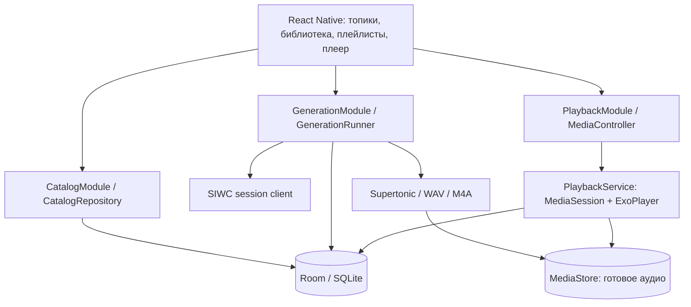

# Подкасты v2 — техническая спецификация

Дата: 25 октября 2026 года, Asia/Tbilisi. **Основные этапы 0–6 реализованы в 1.8; фоновая генерация остаётся необязательным планом.** База: `ac1eaa7`, Android-прототип 1.2. Продуктовые правила — в [PRODUCT SPEC](PODCAST_V2_PRODUCT_SPEC.md), порядок работ и проверки — в [плане](PODCAST_V2_PLAN.md), фактические результаты — в протоколах [SIWC/TTS/плеера](STAGE0_V2_TEST_2026-10-25.md) и [Room/навигации](STAGE0_COMPATIBILITY_TEST_2026-10-25.md). При конфликте с прежней [спецификацией прототипа](PODCAST_PROTOTYPE_SPEC.md) разделы реализованных этапов и протоколы фиксируют работающую сборку; остальные разделы описывают целевую v2.

## 1. Что сохраняем и что меняем

Сохраняем React Native 0.86.3 / React 19.2.3, Kotlin, TurboModules, SIWC и защищённое хранилище с исправленным refresh, Responses SSE collector, закреплённую поставку Supertonic 3 INT8 / sherpa-onnx 2.0.0, AAC/M4A через Media3 и доступ внешнего плеера через content URI. Цель — Pixel 10 Pro / Android 17; minSdk 31, compile/target 36 остаются до отдельного обоснованного изменения.

Изменения архитектуры необходимы, потому что текущие компоненты рассчитаны на один выпуск:

| Сейчас | В v2 |
| --- | --- |
| `PodcastCoordinator`: текст, TTS, сохранение и Player вместе | Независимые сервис воспроизведения, исполнитель генерации и репозитории |
| `LatestAudioStore` удаляет предыдущий файл | Библиотека всех выпусков и публикация отдельного AudioAsset |
| `current.json` и один `draft/` | Room + отдельные рабочие каталоги заданий |
| `PodcastModule.onHostPause` останавливает Player и генерацию | UI отключается от контроллера; Player остаётся в MediaSessionService; генерация получает отдельную политику жизненного цикла |
| Жёсткие русский язык, 3000 символов и timeout TTS 120 с | Профиль языка, уровень подробности, ограничение по этапам и фрагментам |
| Тестовые команды в основном TurboModule/UI | Пользовательские команды и отдельные тестовые APK/наборы |

Не переписывать исправленный OAuth в ходе UI-рефакторинга. `ForegroundGate` нужен прежде всего интерактивному входу; его нельзя просто удалить ради фонового плеера. Самому плееру OpenAI и OAuth не нужны.

## 2. Компоненты и зависимости

Room — единственный источник истины для структуры, записей, связей, заданий и позиции. Его размещаем на Kotlin-стороне, чтобы сервис плеера и восстановление не зависели от запуска JavaScript. React хранит только состояние интерфейса, фильтры и несохранённые поля. Не создавать вторую независимую SQLite/AsyncStorage-копию библиотеки в JS. Room предоставляет слой над SQLite и поддержку транзакций/миграций. [Android Room](https://developer.android.com/training/data-storage/room).

Новые зависимости при реализации:

- `androidx.media3:media3-session:1.11.1`, согласованно с уже используемыми exoplayer/transformer;
- Room runtime/compiler **2.8.5**, KSP **2.1.20-2.0.1**, `ksp.useKSP2=true`: сборка и изолированные SQLite-тесты на Pixel прошли с Kotlin 2.1.20, AGP 8.12.0 и Gradle 9.3.1. В этапе 0 Room подключён только к stageZero; перенос в продуктовую конфигурацию и бизнес-схема выполняются на этапе 1. Room testing при необходимости добавляется согласованной версии; coroutine-API выбирается при реализации, в compatibility-пробе использованы синхронные DAO на worker. [Официальный релиз и подключение](https://developer.android.com/jetpack/androidx/releases/room);
- React Navigation: native **7.5.1**, native-stack/bottom-tabs **7.21.0**, react-native-screens **4.30.0**; safe-area-context **5.10.1** переиспользован без обновления. Версии закреплены в package.json/lockfile; тестовые stack/tabs/Back/theme/recreate прошли на Pixel с Fabric/Hermes. Для MainActivity при переносе native-stack установить проверенный `RNScreensFragmentFactory` перед super.onCreate. [Установка](https://reactnavigation.org/docs/getting-started/), [native stack](https://reactnavigation.org/docs/native-stack-navigator/).

Не нужны сервер, Python на телефоне, отдельный OpenAI SDK в JavaScript, второй аудиоплеер поверх Media3 или embeddings. Изображения/обложки, тяжёлая UI-библиотека и drag-and-drop не являются зависимостями первой реализации.

## 3. Локальная модель данных

Идентификаторы — UUID, не названия и не пути дерева. Время — epoch milliseconds. Ни bearer, ни refresh-токен в Room не записываются. Все операции изменения порядка/связей — транзакции. Ниже логическая схема; точный DDL и индексы фиксируются при реализации.

| Таблица | Основные поля и ограничения |
| --- | --- |
| `Topic` | id, rootNodeId, goal, audience, languageProfile, defaultContentSettings, outlineDepth, structureRevision, createdAt, updatedAt; outlineDepth управляет следующими предложениями, глобальная глубина дерева не больше 4 |
| `TopicNode` | id, topicId, parentId, kind ROOT/SECTION/QUESTION, title, description, siblingOrder, contentRevision; один ROOT на топик; QUESTION без детей |
| `Podcast` | id, title, normalizedTitle, sourceQuestion, contextSnapshot, languageProfile, contentSettings, actualWordCount, promptVersion, textModel, scriptJson, scriptHash, state, audioAssetId, createdAt; созданная версия не меняет сценарий/аудио в прежнем ID |
| `NodePodcast` | nodeId, podcastId, role MAIN/EXTRA, profile, position; не более одного MAIN на `(nodeId, profile)`; уникальная связь пары node/podcast |
| `Tag` / `PodcastTag` | редактируемое имя, normalizedName; связи many-to-many, максимум 5 тегов на выпуск |
| `Playlist` | id, kind TOPIC/MANUAL, topicId nullable, title, revision; один TOPIC на топик |
| `PlaylistItem` | только MANUAL: playlistId, podcastId, position; уникальный podcastId в подборке |
| `GenerationBatch` | id, immutable request snapshot, createdAt; итоговые счётчики рассчитываются из заданий |
| `GenerationJob` | id, batchId nullable, podcastId nullable, kind OUTLINE/SCRIPT_AUDIO, sourceNodeId nullable, nodeRevision, settingsSnapshot, dedupeKey, phase, status, checkpoint, attempt, errorCode, operationId |
| `OutlineProposal` | jobId, topicId, targetNodeId, baseStructureRevision, mode, validatedTreeJson, status; отделён от применённого дерева |
| `AudioAsset` | id, podcastId, jobId, displayName, contentUri nullable, state, bytes, durationMs, sampleRate, fingerprint; одна текущая публикация на задание |
| `PlaybackSession` / `PlaybackQueueItem` | context kind/id, profileFilter, ordered podcast IDs, queueIndex, positionMs, speed, repeatMode, revision |
| `PodcastProgress` | podcastId, positionMs, completedAt nullable, updatedAt |
| `AppSettings` / `MigrationState` | оформление, defaults, версии миграций; не авторизационные данные |

`contextSnapshot` хранит цель топика, аудиторию, путь названий и описание узла **на момент запуска**, а не всё дерево/все сценарии. Новое название, перенос и удаление узла не переписывают историю созданной записи.

`ContentSettings` — версионированный value object: `presetId` (готовая настройка либо CUSTOM; LEGACY только для импортированных старых выпусков), `targetWordMin`, `targetWordMax`, `depth` (OVERVIEW / EXPLANATORY / DEEP), `intent` (необязательное пожелание к содержанию). Языковой профиль и аудитория остаются отдельными параметрами. Наследование: defaults приложения → топик → пакет → индивидуальная настройка. Перед постановкой задания сохраняется полностью разрешённый snapshot, чтобы последующее редактирование defaults не меняло выполняющийся запрос. Четыре presets раскрываются в объём и погружение; число блоков сценария из них не выводится.

Состояния записи отделены от состояния задания: `DRAFT`, `GENERATING`, `READY`, `FAILED`, `FILE_MISSING`, `DELETING`. `READY` требует подтверждённого опубликованного файла и сохранённых метаданных. Предложение структуры не создаёт фиктивный Podcast.

### Инварианты дерева и связей

- Перемещение не создаёт цикл, сохраняет topicId и глубину не больше 4; корень перемещать нельзя. Порядок соседей нормализуется в одной транзакции.
- Удаление топика/узла удаляет его структуру и связи, но не Podcast/AudioAsset. Ожидающие задания удалённой ветки отменяются; активное получает отмену. Если публикация уже состоялась, выпуск сохраняется в библиотеке без удалённой связи.
- Изменение цели/описания/профиля отражается в revision; уже выполняющееся задание не меняет вход. Его результат показывается как созданный по прежним настройкам и не подменяет более новый результат без проверки revision.
- Перегенерация создаёт новый Podcast. MAIN переключается только после успешного сохранения и проверки актуальности исходного узла. Старый Podcast и ручные плейлисты остаются.
- `dedupeKey` содержит действие, nodeId/revision либо ID самостоятельной формы, профиль, нормализованный snapshot ContentSettings/аудитории/контекста и promptVersion. Уникальность действует для активных заданий; явная новая версия имеет новый request ID.

### Плейлисты и поиск

TOPIC-плейлист не имеет копии `PlaylistItem`: его состав вычисляется из дерева и NodePodcast. Обход в глубину: MAIN выбранного профиля, EXTRA по position, дети по siblingOrder. READY с доступным файлом включается; остальные отображаются как пропуски. Одинаковый podcastId включается один раз. «Все профили» добавляет варианты в стабильном порядке профилей и явно допускает повтор темы на разных языках.

Начало прослушивания создаёт сохранённый снимок очереди из podcast IDs; путь к AudioAsset разрешается в native-коде. Изменения дерева влияют на новую очередь. Удалённый/недоступный файл пропускается с сообщением; если доступных записей нет, воспроизведение останавливается.

Поиск: нормализованное Unicode-название, регистр через Locale.ROOT, `ё → е`, сведение пробелов. Начальный вариант — параметризованный `LIKE` с экранированием `%` и `_`, pagination по 50 записей. На объёме до 10 000 метаданных сначала измерить задержку; FTS добавлять при необходимости, не расширяя поиск на сценарии. Теги — отдельный фильтр по ID.

## 4. Контракты между React Native и Kotlin

Разделить команды по назначению, сохранив небольшое количество native-модулей:

| Модуль | Ответственность |
| --- | --- |
| Catalog | CRUD топиков/узлов, reorder/move, список/поиск подкастов, связи, плейлисты, настройки, удаление |
| Generation | создать предложение структуры, применить/отклонить, поставить одиночный/пакетный выпуск, пауза/продолжение/отмена/повтор |
| Playback | загрузить очередь, play/pause, seek, previous/next, speed/repeat, чтение состояния |
| Auth | вход, выход, статус подключения, каталог моделей; native-сессия остаётся общей |

Все команды возвращают Promise с результатом либо устойчивым доменным errorCode. Долгие операции сразу возвращают jobId, не держат Promise до окончания всего TTS. Команда принимает `clientRequestId`, изменения каталога — также `expectedRevision`; повтор после обрыва bridge не дублирует задание. Ошибка конфликта требует перечитать состояние.

События: `catalogChanged(revision, affectedIds)`, `jobsChanged`, `playbackChanged`, `authChanged`. UI подписывается и запрашивает актуальный snapshot при reconnect. Не пересылать всё дерево и сценарии каждые 500 мс; позиция плеера публикуется отдельно только для видимого интерфейса. Токены и PCM-массивы никогда не пересекают bridge. На первом этапе допустимы версионированные JSON DTO, но не неописанный общий JSONObject с произвольными полями.

## 5. Генерация структуры и сценария через SIWC

### Доступ и форматы

Используется прежний аккаунт, каталог доступных моделей и ресурс Responses. Сохраняются `store:false`, SSE и требование завершённого ответа. Модель выбирается из каталога, а не зашивается в код; исчезновение выбранной модели ставит новые задания на паузу до выбора другой. Нет скрытого переключения на API key или оплачиваемый отдельно маршрут.

Для дерева и сценария предпочтителен `text.format` с `type: json_schema`, `strict: true`. Официальная документация описывает этот режим и необходимость обработки refusal/incomplete. **На этапе 0 текущая SIWC-регистрация и модель `gpt-6.1-sol` успешно прошли проверку двухуровневого дерева и контрольной схемы с enum**, включая случай противоречащей формату текстовой инструкции. Это подтверждение конкретных проверок; произвольные схемы и другие модели требуют собственной проверки. [OpenAI Structured Outputs](https://developers.openai.com/api/docs/guides/structured-outputs?api-mode=responses).

Если сервер явно сообщает, что format не поддержан, предложить структурированный JSON обычным текстовым ответом с локальной проверкой. Capability сохраняется для выбранной модели/регистрации; generic 400/401/429 не считается таким доказательством. Fallback не меняет аккаунт или модель. Ни схема, ни prompt не заменяют локальную проверку глубины, размеров и ссылочной целостности.

### `OutlineV1`

Логический ответ: `{title, description, children:[{kind, title, description, children}]}`. Поля обязательны, отсутствие описания — пустая строка, дополнительные поля запрещены. Позиция задаётся порядком массива; UUID назначает приложение, модель не получает права выбирать существующие ID, URI или команды.

Вход: тема/цель/аудитория, языковой профиль, максимум глубины и число новых узлов, ограниченный контекст выбранной ветки. Для добавления передаются её текущие названия, чтобы уменьшить дубли. Для большого дерева генерируется ограниченная ветка, а не полный экспоненциальный план.

Локальные ограничения: заголовок 1–160 code points, описание до 1000, не более 50 новых узлов за ответ, не более 200 после применения, глубина 1–4 ниже корня. Сырой ответ ограничен 128 KiB и ограничением глубины JSON до рекурсивного обхода. Применение валидного предложения — одна транзакция с проверкой актуальной revision против явно просмотренной версии. Исходная baseRevision остаётся неизменной; при правке дерева пользователь должен заново посмотреть diff и явно подтвердить reviewedRevision перед отдельным Apply. Отказ, оборванный JSON, превышение размера и некорректная структура не изменяют существующий топик.

### `EpisodeScriptV1`

Логический ответ: `{title, summary, segments:[{heading, text}], tags:[string]}`. `text` — только произносимая речь, без Markdown, SSML, кода и URL. Заголовки сегментов служат редакционными метаданными; речь соединяется с естественными переходами, не озвучивает JSON и служебные заголовки автоматически. Название из модели можно изменить в карточке. Невалидные необязательные теги отбрасываются, не теряя хороший сценарий.

В prompt входят языковой профиль, диапазон слов, степень погружения, пожелание к содержанию, конкретный вопрос, цель и аудитория топика, путь родительских названий, краткий перечень соседних тем. Для обзора добавляется список дочерних тем; для вопроса — просьба не пересказывать соседние выпуски целиком. Произвольный пользовательский текст передаётся как данные, не как системные инструкции или TTS control tags. Профили prompts имеют версию, которая сохраняется вместе с результатом.

Политика сценария предметно нейтральна: выбрать подходящую организацию по цели и теме; раскрыть главное в пределах объёма; не вставлять обязательные блоки про ошибки/применение/сравнения; не придумывать факты, цитаты и источники ради насыщенности. Научная неопределённость передаётся явно, но научпоп не превращается в техническую инструкцию. Погружение управляет деталями и связями, аудитория — необходимыми предварительными объяснениями, languageProfile — языковой сложностью. При DEEP и малом объёме приоритет узкому центральному вопросу. `segments` остаётся переменной структуры: не требовать 3–5 элементов или типизированных секций `mistakes/examples/causes`.

Предлагаемые внутренние бюджеты, не обещания длины/времени:

| Диапазон объёма, используемый preset | Ориентир объёма | Жёсткий максимум произносимого текста |
| --- | --- | --- |
| Кратко | 150–250 слов | 3000 code points |
| Стандартно | 350–550 слов | 6500 code points |
| Подробно | 700–1100 слов | 12 000 code points |
| Углублённо | 1200–1800 слов | 20 000 code points |

В CUSTOM технический максимум выбирается по диапазону объёма, а не по depth. Для defaults Кратко — OVERVIEW, Стандартно/Подробно — EXPLANATORY, Углублённо — DEEP. Эти параметры меняются независимо. Число слов считаем только в произносимом тексте, без title/summary/tags; метод подсчёта фиксируется для RU/EN и покрывается тестами сокращений и дефисов. Отклонение от целевого диапазона само по себе не вызывает платный автоматический retry или обрезание речи. Фиксируются actualWordCount и предупреждение о заметном отклонении; пустой текст, hard limit и незавершённый ответ обрабатываются как прежде. Модель не должна добавлять воду ради минимума.

Конкретные бюджеты уточняются по замерам Pixel на этапе 0. Нельзя просто увеличить нынешний `MAX_TEXT`, оставив timeout, хранение и обработку памяти прежними. Финальный текст и фактическая модель сохраняются **до** TTS. После ошибки TTS/кодирования не выполняется новый запрос текста.

Уже измерено на этапе 0: получение 1361 слова заняло 99,6 с с каталогом, при нынешнем HTTP call timeout 120 с запас небольшой. Для длинных сценариев v2 предусмотреть отдельный настраиваемый сетевой бюджет (начальный кандидат 240 с) при сохранении ограниченного ожидания данных и явной отмены; это предложение, не проверенный новый timeout. Для 863 слов один локальный синтез занял 228,9 с, WAV — 45,5 MB, что подтверждает необходимость отдельного бюджета TTS и динамического расчёта диска.

Collector продолжает учитывать P-01: если completed не повторил текст, сохраняются подтверждённые deltas; при наличии финального текста нет дублирования. Refusal, incomplete и EOF до terminal event не считаются готовым сценарием. Исправление JSON/стиля выполняется по явному «Повторить/Исправить», без бесконечного скрытого цикла запросов.

### Язык и качество

LanguagePolicy связывает prompt, валидатор, разбиение фраз и `ttsLang`: `ru_standard → ru`, `ru_simple → ru`, `en_simple_ste → en`. Английский путь описан upstream для уже выбранного пакета; на этапе 0 создан 63-секундный образец, пользователь подтвердил понятную речь. Произвольные имена/термины и полный профиль простого английского ещё требуют проверки. [Supertonic 3 English, включая Kotlin](https://k2-fsa.github.io/sherpa/onnx/tts/all/English/supertonic-3-en.html).

В `en_simple_ste` целимся преимущественно в фразы до 20 слов, отмечаем предложения длиннее 25, избегаем идиом, используем один термин для одного понятия, определяем специальные слова при первом употреблении. Технические названия/API сохраняются, а не заменяются неверным «простым» словом. Это профиль проекта по мотивам ASD-STE100, не полный STE checker. Для простого русского также используем короткие фразы и явные определения, не вводя буквальный английский словарь.

Синтаксические лимиты, пустой ответ, непроизносимая разметка и грубая ошибка языка блокируют TTS. Доля кириллицы из v1 не является универсальной проверкой: английские технические термины в русском допустимы. Эвристики длины предложения и терминологии формируют предупреждения качества, не «сертификат 80%». На эталонном наборе нужна человеческая оценка понятности и отсутствия смысловых потерь. Числа, сокращения и сегментация тестируются отдельно для RU и EN.

## 6. Очередь создания и восстановление

Базовый v2: один native GenerationRunner на процесс, выполняющий по одному заданию, пока приложение foreground. Смена вкладки не влияет на работу. RN-компонент не владеет потоком генерации. Room хранит очередь; после перезапуска никакой платный/лимитируемый запрос не запускается автоматически.

Для видимой Activity с активным заданием использовать `FLAG_KEEP_SCREEN_ON`, снимая флаг при паузе/завершении. Он не должен препятствовать ручной блокировке и не заменяет foreground service. Это устраняет обычный тайм-аут дисплея во время длинного выпуска без обещания работы в фоне. [Android: управление отключением экрана](https://developer.android.com/develop/background-work/background-tasks/awake/screen-on).

Фазы: `QUEUED → GENERATING_TEXT → SCRIPT_READY → SYNTHESIZING → WAV_READY → ENCODING → PUBLISHING → COMPLETED`. Для OUTLINE — получение/проверка → предложение пользователю, без TTS. Статус отдельно: `RUNNING`, `PAUSING`, `PAUSED`, `WAITING_AUTH`, `WAITING_NETWORK`, `FAILED`, `CANCELLED`.

Каждое задание имеет неизменяемые входные настройки, рабочий каталог `noBackupFilesDir/jobs/<jobId>/` и номер попытки. После process death незавершённый RUNNING становится PAUSED; восстановление сначала сверяет durable checkpoints. Операции публикации доводятся до согласованного состояния до новых генераций.

Сохраняем:

1. Завершённый валидный сценарий в БД с hash.
2. Законченные TTS-фрагменты в отдельных `.wav` через временный файл и rename. Manifest/checkpoint с index, scriptHash, параметрами голоса, sample rate, числом frames и hash записывается после файла. Частичный фрагмент не используется.
3. Полный WAV после последовательной сборки проверенных фрагментов. Не держать весь выпуск в PCM-массиве; память ограничена текущим фрагментом.
4. Проверенный M4A перед публикацией. Encoder output `.part` не является готовым файлом.

Пауза/уход в фон: остановить новые задания, отменить текущий сетевой запрос или незавершённый фрагмент, сохранить законченные этапы. В UI сначала «Останавливаем», затем «На паузе». JNI-отмена остаётся кооперативной; нельзя обещать мгновенный останов, пока он не измерен. Если возвращение произошло до подтверждённой остановки, второй worker не стартует. При продолжении проверяются scriptHash/settings и файлы; несовпавшие checkpoints не склеиваются.

Сетевой обрыв до сохранения terminal response может означать, что сервис уже выполнил запрос. Локальная идемпотентность предотвращает двойное нажатие, но не гарантирует exactly-once на стороне OpenAI. Такой этап возобновляется только явным действием; в UI указано, что текст будет запрошен заново.

Ошибки: ошибка одного сценария помечает его и позволяет перейти к следующему; отсутствие авторизации, лимит подписки, нехватка диска, OOM и перегрев ставят весь пакет на паузу. UI сообщает причину, не выполняет частый автоматический retry. Выход из аккаунта отменяет его сетевые операции; готовые файлы и локальная озвучка уже сохранённого текста доступны.

Предлагаемые пределы: 20 новых заданий за запуск, один TTS одновременно, до 20 минут на локальный этап одного максимального выпуска с отдельным watchdog фрагмента. Числа требуют замера, не обозначают гарантированное время. Для записи резервировать размер полного PCM, фрагментов/сборки, encoded output и копии MediaStore плюс запас; прежних фиксированных 32 MiB недостаточно. При одновременном прослушивании приоритет у плеера; generation concurrency остаётся 1, параметры CPU проверяются на Pixel.

## 7. Надёжная публикация и удаление аудио

Сохраняем M4A/AAC-LC mono и MediaStore `Podcasts/PodcastGenerator/`. Имя содержит стабильный asset/job UUID и не зависит от переименования топика. Во внешнее приложение передаётся отдельный content URI с временным read grant; широкое разрешение на всю аудиотеку не нужно для собственных записей.

БД и MediaStore не имеют общей транзакции. Требуется отдельный протокол публикации:

1. Создать AudioAsset со статусом `ALLOCATING`, jobId и уникальным displayName **до** insert.
2. Вставить собственную строку с `IS_PENDING=1`, сохранить URI.
3. Скопировать M4A; проверить размер и дорожку; затем убрать `IS_PENDING`.
4. Транзакцией подтвердить READY, завершить job и добавить актуальную связь с узлом. Если узел удалён/изменён, готовый выпуск остаётся самостоятельным с уведомлением об исходном контексте.
5. После фиксации убрать рабочие WAV/фрагменты, но не другие готовые выпуски.

При остановке после insert до сохранения URI искать только собственную строку по уникальному имени и папке. При остановке после публикации до DB commit восстановить READY, не публиковать второй файл. Null/ошибка query означает неизвестное состояние, а не отсутствие: сохранить запись восстановления и повторить позже. Пустой успешный Cursor подтверждает отсутствие. Эти инварианты продолжают P-02; тесты переносятся на несколько AudioAsset.

Удаление Podcast: проверить затронутые связи, убрать его из текущей очереди при необходимости, записать `DELETING`; удалить только собственный AudioAsset; после подтверждения убрать связи и завершить удаление. При сбое сохранить задачу очистки. Если файл уже отсутствует и это подтверждено запросом, очистку можно завершить. Приложение не очищает папку по маске и не удаляет чужие файлы.

Отвязка от топика/плейлиста не вызывает эту процедуру. Новая версия записи не вызывает её автоматически. Очистка рабочего каталога допустима только для завершённого/явно отменённого задания и после проверки, что файлы не нужны активному runner. При малом диске приложение предлагает очистку, не удаляет старые выпуски само.

## 8. Фоновое воспроизведение — обязательная часть

`PlaybackService : MediaSessionService` владеет единственным ExoPlayer и MediaSession. Activity/TurboModule используют MediaController. `onHostPause`, размонтирование экрана, JS reload и потеря controller connection не вызывают pause/release плеера. Lifecycle сервиса отвечает за освобождение ресурсов. Это штатный путь Media3 для работы при закрытом UI. [Android background playback](https://developer.android.com/media/media3/session/background-playback).

Manifest: `FOREGROUND_SERVICE`, `FOREGROUND_SERVICE_MEDIA_PLAYBACK`, тип сервиса `mediaPlayback` и MediaSessionService intent filter. Системное уведомление и lock-screen controls получают название, контекст и длительность из MediaMetadata. Команды по ID разрешают только записи библиотеки; внешнему controller не выдаются команды удаления/генерации и произвольные file/content URI.

Настройки ExoPlayer: `USAGE_MEDIA`, `CONTENT_TYPE_SPEECH`, штатный audio focus, pause при becoming-noisy. На Android с target 35+ запрос audio focus допустим для top app либо foreground service, что нужно учесть при восстановлении с lock screen. [Audio focus](https://developer.android.com/media/optimize/audio-focus).

Позицию сохранять примерно раз в 5 секунд и немедленно при pause/seek/смене записи; очередь и индекс — транзакционно. Истина о позиции — Player, не JS-таймер. После process death/reboot предложить восстановить очередь в состоянии paused; запуск возможен по явному UI/системному действию. Force stop не обходится. Удаление приложения из recents при активном воспроизведении не прекращает его; при отсутствии воспроизведения сервис можно остановить.

P-03 сохраняется: play после ошибки на том же URI вызывает prepare из STATE_IDLE; после STATE_ENDED переход к началу, обычная пауза позицию не сбрасывает. Плеер не пересоздаётся при переключении вкладок. Изменение метаданных не перезапускает текущий трек. Если следующая запись недоступна, очередь ищет следующую доступную, не попадает в бесконечный repeat-цикл.

Для v2 не экспортируем дерево в Android Auto/внешние browser clients: внутренней библиотеке достаточно Room + собственный UI. MediaLibraryService и внешний просмотр каталога можно добавить отдельно.

## 9. Фоновая генерация — необязательное расширение

Это отдельная задача, а не настройка MediaSessionService. Если основная версия стабильна и техническая проба проходит, добавляем `GenerationService` с постоянным уведомлением, progress и cancel/pause. Запуск — явным действием при видимом приложении. Room и GenerationRunner переиспользуются; Headless JS не становится источником истины.

На API 35+ локальный TTS/кодирование проектируются как `mediaProcessing`, сетевое получение результата — как `dataSync`, с соответствующими permissions и активными типами по фазе. Применимость к реальному pipeline подтверждается отдельной проверкой; `mediaPlayback` не используется как обходной тип для вычислений. Для API 31–34 первая версия расширения может оставить генерацию foreground-only с явным описанием, сохранив фоновое прослушивание. [Типы FGS](https://developer.android.com/develop/background-work/services/fgs/service-types).

У dataSync и mediaProcessing есть фоновые временные квоты — по 6 часов в 24 часа на тип; при timeout сервис должен быстро остановиться. Сохранить checkpoint/PAUSED и вызвать stopSelf, не ждать окончания долгого JNI на main thread. Любой поздний callback отменённой попытки игнорируется. Восстановление не обещает автоматический старт из произвольного фона или BOOT_COMPLETED. [Android FGS timeouts](https://developer.android.com/develop/background-work/services/fgs/timeout).

Проба должна проверить выдачу/отказ уведомлений, блокировку экрана, CPU/sleep, ограниченный wake lock при необходимости, длительную очередь, callback timeout и одновременный Player. Если для надёжности потребуется отдельный TTS-процесс, агрессивные battery exemptions или обходы ограничений ОС, расширение переносится; основной v2 от него не зависит.

## 10. Миграция с 1.2 без потери сессии и файла

Application ID и ключ подписи сохраняются. Промежуточный этап 1 выпущен локально как 1.3 / versionCode 4; итоговая versionName v2 остаётся 2.0 с последующим увеличением versionCode. OAuth storage не переносится в Room и не сбрасывается. Старый coordinator блокируется до окончания миграции; нельзя одновременно запускать старый механизм «последний файл» и новую библиотеку.

1. Прочитать legacy journal; корректно завершить подтверждённые pending/cleanup через прежние проверенные правила. При неизвестном состоянии MediaStore приостановить миграцию, не удалять данные.
2. В транзакции импортировать последний выпуск в Podcast/AudioAsset, сохранив URI, тему, сценарий и метрики. Профиль `ru_standard`; настройки помечаются LEGACY с исходным ориентиром 120–180 слов, без выдуманного пожелания или ретроспективного изменения сценария. Топик создавать не обязательно: запись видна в библиотеке.
3. Валидный незавершённый draft импортировать как paused job; сопоставить сохранённый текст/WAV/M4A с его ID. Не отправлять новый Responses автоматически. Если draft уже опубликован, не создавать дубль.
4. Зафиксировать unique legacy-import key и MigrationState. Повтор после crash безопасен. JSON/черновик оставить как приватный migration backup до следующего успешного цикла; не переносить или удалять их раньше DB commit.
5. Если файл подтверждённо отсутствует, сохранить его метаданные как FILE_MISSING. Отказ чтения не превращать в «пустую библиотеку».

Проверки: миграция из состояния ready, pending insert, published-before-commit, cleanup failure, saved script, WAV_READY, пустой установки; остановка между шагами и повтор. `fallbackToDestructiveMigration` запрещён. Для следующих схем Room использовать явные миграции и экспорт схем в Git.

## 11. Оформление, приватность и тестовые функции

ThemePreference: system/light/dark. JS ThemeProvider использует единые semantic tokens; системная тема читается реактивно через `useColorScheme`, а не один раз при старте. Native окна, системные панели и React Navigation получают тот же effective theme. Настройка сохраняется до следующего запуска. [React Native 0.86 Appearance](https://reactnative.dev/docs/0.86/appearance).

В release не маршрутизируются и не отображаются тестовые SIWC/TTS-экраны. Удалить публичные тестовые JS-команды `sendPrompt`, `refreshSession`, `runRussianSample` из пользовательского контракта после перевода регрессионных тестов на core/test APK. Сам механизм refresh остаётся. Вход/выход и выбор модели — продуктовые функции, не удаляются вместе со старым экраном.

Диагностика: только IDs операций, этапы, длительности, безопасные коды ошибок и размеры; без токенов, callback query, пользовательских тем/сценариев, email и полного дерева. Данные на устройстве сохраняются приватно, наружу публикуется только аудио по уже принятому правилу. Отключённый backup v1 сохраняется; синхронизация и полноценный экспорт библиотеки не обещаются этой версией.

## 12. Подтверждения и оставшиеся границы проверок

| Проверка | Почему до основной реализации |
| --- | --- |
| Structured Outputs через текущую SIWC-сессию | Дерево и контрольная enum-схема подтверждены; универсальную поддержку схем/моделей не предполагаем |
| Английский Supertonic на Pixel | Короткий образец и понятность подтверждены; широкий набор терминов и языковые политики пока не оценены |
| Подробный/углублённый текст | Подтверждены 863/1361 слово, M4A 8:36/13:02, наблюдённая PSS до 627 MiB и отмена около 10 с; верхние границы и серия в одном TTS instance ещё не проверены |
| MediaSessionService без активного RN UI | Подтверждены короткий lock-screen прогон, системные клавиши, запуск через app-owned MediaController и работа после закрытия Activity; гарнитура и холодное восстановление пока не проверены |
| Room/KSP с текущим Kotlin/Gradle | Сборка, generated DAO/DB и тесты реального SQLite прошли; настоящая бизнес-схема и импорт legacy JSON проверяются на этапе 1 |
| React Navigation с Fabric/Hermes | Проверены stack/tabs/Back, тема, возврат из фона и Activity.recreate; продуктовые маршруты и восстановление после process death — следующие этапы |
| Библиотека вместо LatestAudioStore | Миграция и многозаписная публикация должны сохранять исправления P-02/P-04 |

Ссылки в документе проверялись 25 октября 2026 года. Текст ASD-STE100 частично доступен в индексируемом официальном PDF, прямое получение PDF инструментом дало 403; полная проверка словаря/стандарта не выполнялась. Это не блокирует собственный профиль простого английского, но исключает заявление о формальном соответствии STE.

## Реализованный срез этапа 1

[Отчёт этапа 1](STAGE1_LIBRARY_TEST_2026-10-25.md) описывает фактическую схему Room 1, перенос и проверку на Pixel. Podcast/AudioAsset/GenerationJob реализованы компактно: поисковые поля карточки вынесены в колонки, прежние метаданные и checkpoints пока хранятся JSON внутри Room. Это промежуточная схема, а не утверждение, что весь контракт будущей v2 уже реализован. У каждого AudioAsset собственный журнал публикации; глобальное удаление предыдущего выпуска исключено. SIWC остаётся в исходном защищённом хранилище. Контентные профили и остальные таблицы будут добавляться явными миграциями следующих этапов.

## Реализованный срез этапа 2

В 1.4 Player перенесён в MediaSessionService; интерфейс подключается через отдельный PlaybackModule/MediaController и получает короткое состояние. Room 2 добавляет единственную playback_state с упорядоченными IDs/позицией/скоростью/repeat и явной миграцией из схемы 1. Топики и ручные плейлисты пока не реализованы; очередь можно собрать из всей готовой библиотеки или отдельного выпуска. UI имеет seek к секунде, а не slider. [Протокол и статус проверки](STAGE2_PLAYBACK_TEST_2026-10-25.md).

## Реализованный срез этапа 3

1.5 добавляет Room 3: topics/topic_nodes/node_podcasts, явную миграцию 2 → 3 и цепочку из схемы 1. TopicTree и транзакционный TopicRepository обеспечивают дерево, порядок, связи и expectedRevision. ROOT=0, до четырёх уровней ниже него и 200 узлов включая корень. Ручной перенос только внутри топика; вопрос без детей. Разрушительные действия подтверждаются в UI; каскад направлен к связям, а не к аудио. При удалении Podcast revisions затронутых топиков меняются в транзакции удаления.

Производный плейлист ветки — DFS, MAIN/EXTRA, dedupe; в PlaybackClient передаётся независимый список IDs. Смена структуры не меняет активную очередь. Поиск прикрепления — страницы по 50 с безопасным LIKE, длительностью и датой для одноимённых выпусков. Вкладки/вложенный stack используют ранее закреплённый React Navigation; мини-плеер общий. Пока нет catalogChanged stream: данные читаются по focus/refresh, topic list и snapshot без пагинации. Язык связей ru_standard; параметры AI-плана, языковые defaults и генерация по узлам остаются будущими этапами. [Фактическая приёмка](STAGE3_TOPICS_TEST_2026-10-25.md).

## Реализованный этап 4 — 1.6

Room 4 добавляет outline_proposals и явную миграцию 3 → 4 с сохранением библиотеки, топиков, связей и playback. OutlineRepository хранит неизменяемый контекст и baseRevision, отдельно reviewedRevision и проверенный результат. Статусы: RUNNING, READY, FAILED, CANCELLED, INTERRUPTED, APPLIED, DISCARDED. Перезапуск не отправляет запрос повторно. Последние десять предложений ветки видны в UI, автоматической очистки истории пока нет.

OutlineCoordinator допускает один foreground-запрос, резервируя его до worker. Уход в фон отменяет только этот запрос; плеер независим. Ошибки модели/сети/валидации не меняют дерево. Производный плейлист меняется после применения, загруженная очередь остаётся снимком. Replace удаляет потомков и их связи, сохраняя сам узел и его связи. QUESTION становится SECTION с прежним ID только при Apply. Локальные заголовки-дубли в APPEND, доступная глубина и предел 200 проверяются повторно в транзакции.

Реально используется строгая рекурсивная JSON Schema, 32 768 code points / 128 KiB и ограниченный строгий JSON-reader. Исчезновение выбранной модели вызывает select_model. Текстовый fallback из общего плана в 1.6 не включён: неподдержанный формат — явная ошибка без скрытого второго запроса. Профили языка и ContentSettings остаются этапом 5. [Проверки и границы](STAGE4_OUTLINE_TEST_2026-10-25.md).

## Реализованный этап 5 — 1.7

Room 5 / миграция 4 → 5 добавляет generation_queue и defaults языка/контента Topic. ContentSettings — volume, immersion, intent, audience; профили ru_standard/ru_simple/en_simple_ste связаны с prompt/проверкой/TTS. Настройки, контекст, модель и fingerprint фиксируются в задании. Strict EpisodeScriptV1 проходит bounded JSON reader и локальную проверку речи, до TTS сохраняются script/hash/actualWordCount/qualityWarnings и метаданные. Words-v1 считает дефисные слова, апострофы и десятичные числа единым токеном. JSON ограничен 32 768 code points / 128 KiB, речь — бюджетом объёма. Responses callTimeout 240 с, future 300 с, прежние auth-бюджеты не изменены.

GenerationQueue формирует и повторно проверяет preview, лимит 20 новых/100 незавершённых, профиль MAIN и активные задания. requestId обеспечивает локальную идемпотентность. Один worker выполняет SIWC/TTS, отдельный DB-worker отвечает на preview/enqueue/cancel во время синтеза. Claim запускает только QUEUED, не воскрешая CANCELLED. Незавершённые задания после смерти процесса остаются PAUSED. Нет автоматического платного повтора. Файлы checkpoint находятся в podcast/jobs/<id>/chunks; PCM собирается поточно, с hash/rate/voice identity. Готовый Script/WAV/M4A не пересоздаётся при продолжении. Для ресурсного резерва используется консервативная оценка трёх PCM-копий и 64 MiB; TTS имеет общий бюджет 20 минут и watchdog фрагмента 120 с.

В транзакции READY-публикации подтверждаются COMPLETED и актуальная связь. Fingerprint контекста заменяет сравнение глобальной revision для автопривязки: собственные публикации пакета не делают следующие вопросы устаревшими. Смена defaults не меняет настройки уже созданного задания. При изменении/удалении исходного контекста результат остаётся в библиотеке с attachmentWarning. MAIN с потерянным файлом демотируется в EXTRA при публикации нового готового MAIN; аудио других записей не удаляется. Производный плейлист фильтруется по текущему языку топика, все связи сохраняются.

[Протокол этапа 5](STAGE5_GENERATION_TEST_2026-10-25.md) содержит реальные M4A, паузу/продолжение, проверки UI и границы: STE — профиль с эвристиками, не сертификат; полная качественная матрица/thermal/OOM остаются расширенной приёмкой. Фоновая генерация пока не включена.

## Реализованный этап 6 — 1.8

Room 6 добавляет playlists/playlist_entries, миграцию 5 → 6 и транзакционный PlaylistRepository. Composite PK устраняет повтор одного podcast ID, cascade направлен только к ссылкам. Удаление Podcast меняет revisions ручных списков и удаляет его ссылки в той же транзакции, что и прежние связи топиков. Автоматические списки вычисляются из дерева с выбранным профилем/всеми языками, copyTopic проверяет revision и сохраняет только IDs/порядок. Активная очередь независима. PlaybackClient.updateQueue явно применяет новый набор, сохраняя текущий ID/позицию, если он остался, и прежнее playWhenReady; пустой набор не применяется.

NativeLibraryUI предоставляет короткие операции каталогов/списков/предпочтений на отдельном worker, не блокируя TTS. AppPreferences содержит только тему, профиль, ContentSettings и модель; последняя legacy-модель читается из input.json, OAuth не переносится. ThemeProvider применяет две семантические палитры и системный выбор, AppCompat.DayNight восстанавливается до Activity.onCreate и управляет native-окнами. Общий владелец bootstrap каталога исключает конкурирующие стартовые listModels на разных вкладках.

Основная навигация: Topics/Podcasts/Playlists, Settings в верхнем native stack, мини-плеер доступен и там. Settings содержит аккаунт/модель/defaults/хранилище. Test prompt/voice/refresh/share diagnostics, PSS/HTTP/JSON и внутренние времена не входят в release UI; экспериментальный stageZero остаётся отдельным вариантом. В rendered UI используются контрастные palette tokens, кнопки min48dp/selected/disabled, доступная подпись текущего выпуска. [Результаты этапа 6](STAGE6_PLAYLISTS_THEME_TEST_2026-10-25.md) фиксируют автоматические наборы и ограничения TalkBack/масштаба UI/фоновой генерации.
